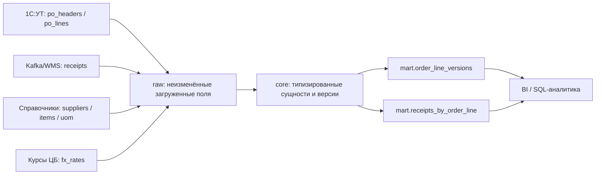

# 02_model.md — Проектирование аналитического решения

## Цель и границы

Целевой пилотный домен — закупки: анализ цены, поставщиков, приёмок и качества поставки. Модель разделяет сырые источники, нормализованный core и витрины. Это уменьшает риск повторного размножения событий приёмки и сохраняет исходные версии строк заказа до подтверждения правил разрешения конфликтов.

## Архитектура

## ER-диаграмма

Исходный файл диаграммы: [`02_model_erd.mmd`](02_model_erd.mmd). Он использует Mermaid ER syntax. Внешние связи, которые требуют временного условия, показаны как логические связи, а не обычные FK.

## Почему такая схема

- **Raw** сохраняет полученные строки и поля для трассировки и повторной обработки. Это не архив исходных байтов CSV: контрольные суммы и метаданные загрузки следует добавить в промышленном контуре.
- **Core** типизирует факты и справочники, разделяет шапку заказа, наблюдаемые версии строки, события приёмки, версии поставщика, номенклатуру, ЕИ и валютные курсы.
- **Marts** дают отдельное зерно версии строки заказа и агрегата приёмок на строку заказа. Агрегат приёмок не нужно напрямую присоединять к каждой версии без разрешения версий строки.
- Не удаляем конфликтующие строки автоматически. `updated_at` сохраняется, но сортировка по нему не считается доказательством «последней истинной версии», пока источник не подтвердит семантику.
- Историчность поставщика моделируется как SCD Type 2: отдельная строка на версию, `valid_from`/`valid_to`. Для отчёта на дату заказа используется as-of join. Конвенция границ интервала требует подтверждения.
- Валюта сохраняется в исходном виде. Рублёвый пересчёт делается отдельным слоем после согласования даты курса, fallback-правил и округления.
- Цены сравниваются только после пересчёта количества в базовую ЕИ через справочник `uom`; отсутствующий коэффициент блокирует сравнение.
- Номенклатура без надёжного ключа остаётся в `unknown/unmatched`, а не сопоставляется по похожему названию автоматически.

## Зерно таблиц

| Таблица | Зерно: одна строка = ... | Ключ / правило |
|---|---|---|
| `raw_po_headers` | одна строка исходного файла шапок заказа | исходная строка/поля; не нормализует версии |
| `raw_po_lines` | одна строка исходного файла строк заказа | исходная строка; повторения сохраняются |
| `raw_receipts` | одна строка исходного файла приёмок | `receipt_id` как кандидатный ключ снимка |
| `raw_suppliers` | одна строка версии поставщика из файла | сохраняет историю версий |
| `raw_items` | одна строка записи номенклатуры | ключ источника |
| `raw_uom` | одна строка единицы измерения | ключ источника |
| `raw_fx_rates` | одна строка курса на дату и валюту | дата + валюта |
| `core_po_header` | один заказ (`order_id`) | `order_id` |
| `core_po_line_version` | одна наблюдаемая версия/строка источника заказа | `line_version_sk`; `source_row_no` уникален |
| `core_fact_receipt` | одно событие приёмки по текущему ключу снимка | `receipt_id`; устойчивость ключа требует подтверждения |
| `core_supplier_version` | одна версия поставщика | `supplier_version_sk`; интервал валидности |
| `core_dim_item` | одна номенклатурная позиция | `item_id` |
| `core_dim_uom` | одна единица измерения и её коэффициент | `uom_code` |
| `core_dim_fx_rate` | один курс на дату и валюту | `(rate_date, currency)` |
| `mart_order_line_versions` | одна обогащённая наблюдаемая версия строки заказа | `line_version_sk` |
| `mart_receipts_by_order_line` | одна пара `(order_id, line_no)` с агрегатами приёмок | `(order_id, line_no)` |

## Обработка обязательных сценариев

1. **История поставщика:** SCD2, as-of join по дате заказа и интервалу валидности. Если совпадений нет или их больше одного — флаг DQ, не подставлять `is_current`.
2. **Мультивалютность:** хранить `currency` и исходную цену; курс хранить отдельно. Для Q2/Q3 определить с владельцем, использовать курс на дату заказа, поставки или учётного документа. До подтверждения не заявлять итоговые суммы как финансовые.
3. **Разные ЕИ:** `qty_base = qty × factor_to_base`; цена за базовую ЕИ рассчитывается с согласованной формулой. Неизвестный/неположительный коэффициент — исключение из сравнения с явным флагом.
4. **Отмены и изменения:** сохранять наблюдаемые версии; построить mapping статусов и правило канонической версии отдельно. Отмены исключать из метрик только после подтверждения статусов и момента отмены.
5. **Номенклатура вне справочника:** не отбрасывать. Помечать как unmatched, включать в сверку coverage и отправлять в процесс мастер-данных.

## Метрики

Матрица метрик и предложение по OTIF: [`02_model_metrics.md`](02_model_metrics.md). Определение OTIF является предложением для согласования; «94% против 71%» не объясняется без воспроизведения обеих формул на одном наборе строк.

## Дефекты данных

Проверки и SQL: [`02_model_data_quality.md`](02_model_data_quality.md). Все приведённые числовые результаты пересчитываются SQL-запросами в том же файле. Дефекты разделены на наблюдаемые проверки и гипотезы о причинах.

## DDL и сборка

- Целевой DDL PostgreSQL: [`02_model_ddl_postgresql.sql`](02_model_ddl_postgresql.sql).
- Проверяемая сборка фактической SQLite-модели: [`02.1_model_build.sql`](../02.1_model_build.sql), база: [`severtrade_model.db`](../severtrade_model.db).
- Валидация текущей SQLite-модели: [`02.1_model_validation_ru.md`](../02.1_model_validation_ru.md).

## Что нужно подтвердить до production

- семантику `updated_at`, статусов и удаления/отмены строки;
- границы `valid_from`/`valid_to` у поставщиков;
- стабильность и семантику `receipt_id` относительно `event_id` из API-примера;
- официальное правило OTIF и период/часовой пояс;
- дату курса, fallback-правило и округление;
- коэффициенты ЕИ и правила возвратов/брака;
- финансовое событие, по которому сверяется закупочный оборот.
